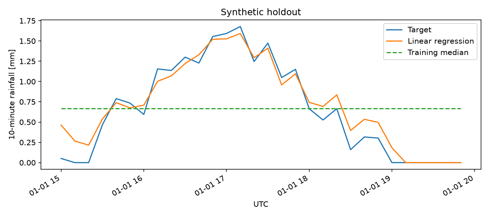

# Radar-based rainfall estimation | SimMod group project

A reproducible baseline that estimates **10-minute ground rainfall depth** from weather-radar reflectivity (DBZH) around Cologne. It matches gauge timestamps to radar scans, extracts simple reflectivity features, and evaluates linear regression on a later time period. This repository contains the baseline implementation and an independently runnable synthetic demo.

## Run without course data

From the repository root, with Python 3.11 or newer:

```bash
python -m venv .venv
source .venv/bin/activate
python -m pip install -r requirements.txt
python src/run_demo.py --synthetic
python -m unittest discover -s tests -v
```

The demo generates deterministic HDF5 radar arrays and CSV targets under `outputs/synthetic_inputs/`. It writes `outputs/metrics.json` and `outputs/holdout.png`. Synthetic scores check the implementation; they do not measure performance on Cologne observations.

### Example synthetic holdout

120 generated pairs: 90 for training and 30 for testing. The test window is 15:00–19:50 UTC on 1 January 2025 (synthetic timestamps).

| Model | MAE (mm) | RMSE (mm) |
| --- | ---: | ---: |
| Training median | 0.500 | 0.570 |
| Linear regression | 0.109 | 0.144 |



## Use authorised course data

The original radar and gauge observations were supplied for the university course. There is no verified public download for those exact files. Obtain them from the course materials or ask the teaching team for access. No original observations or run artefacts are included in the current checkout.

Place files under the ignored `radar/` and `data/` directories, or pass other local paths:

```bash
python src/run_demo.py --radar-dir radar \
  --precip-csv data/precip_10min_long_balanced.csv --station NMS0101
```

- **Radar:** HDF5 files under nested directories are supported. Filenames contain a UTC timestamp such as `-20210707000005700-` (the first 14 digits encode seconds). The reader expects `dataset1/data1/data` and gain/offset metadata in `dataset1/data1/what`.
- **Gauge CSV:** columns `Timestamp` (interval end), `Station` and `Precipitation` (depth in mm over 10 minutes). Timestamps without an offset are interpreted as UTC. Invalid or negative targets are excluded. A station lookup is unnecessary for these global features.
- **Outputs:** set `--out-dir` to keep real and synthetic runs separate. Git ignores the default output directory.

## Method and evaluation

1. Match each valid gauge target to the latest radar scan at or before its timestamp, within a 10-minute tolerance by default.
2. Decode reflectivity into dBZ, exclude missing and below-detection codes, and compute the mean, maximum and 90th percentile over finite pixels.
3. Hold out the last 25% of usable pairs in time order. Purge training rows that share a test scan or overlap the first test target's 10-minute accumulation window.
4. Compare nonnegative linear-regression estimates with the training-period median. Report MAE and RMSE in mm, sample counts and the exact UTC date ranges.

This is an estimate at the gauge interval end. It can use a scan during that interval, so it does not establish forecast skill. The features summarise the full radar frame rather than a neighbourhood around the station. One holdout does not establish generalisation across stations, seasons or storm events.

## Project credit

University of Cologne SimMod group project. Contributors: Beshoy Hanna Ayaad Labib, Fariba Yazdanjooei, Mohammed Fawaz Nawaz, Pelin Su Kaplan, Raj Nandini Singh and Udayan Mishra. Course data are distributed separately; access and redistribution follow the provider's terms.
